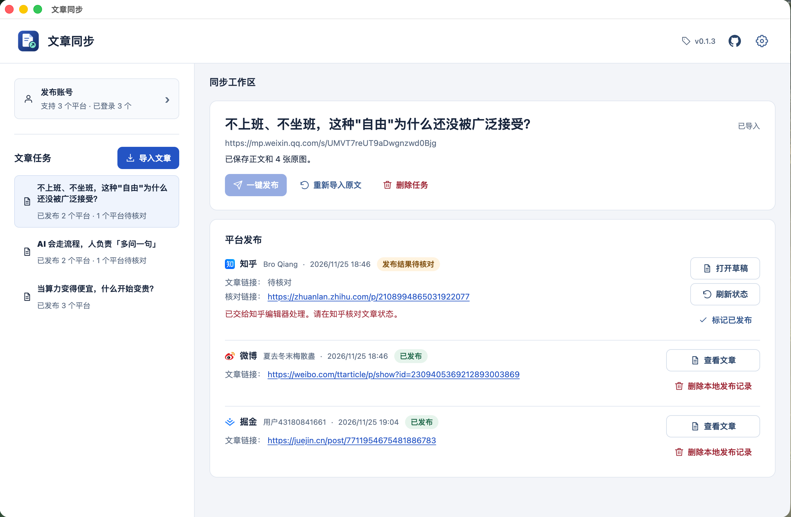

# 文章同步（Article Relay）

将微信公众号文章的正文和原图导入本机，再发布到知乎、微博、掘金或简书。适合需要分发原创或已获转载授权文章的创作者和运营人员。



## 安装

下载适合你系统的安装包，安装后即可使用。Electron 和 Chromium 随安装包提供。 [GitHub Releases](https://github.com/broqiang/article-relay/releases)

## 快速开始

1. **导入文章。** 点击左侧「导入文章」，粘贴微信公众号文章链接并提交。遇到微信验证时，在原文页面完成验证，再点击「继续读取文章」。
2. **登录平台。** 打开左侧「发布账号」，在应用内登录要发布的平台。使用掘金时，在「系统设置 → 默认值设置」查看当前账号的分类和标签。点击「编辑默认值」，在弹窗里选择一个分类和至少一个标签并保存，供单平台发布和一键发布使用。
3. **发布文章。** 选中任务，在对应平台行点击「发布」，或点击「一键发布」逐个平台提交。
4. **核对结果。** 在「平台发布」查看状态和文章链接。打开草稿继续处理后，返回工作区时应用会立即核对发布状态，仍待确认时约 5 秒后再查一次。

在右上角「设置 → 系统设置 → 发布平台设置」卡片中点击「设置」，即可选择启用的平台。默认启用知乎、微博和掘金，简书可手动启用。保存时至少勾选一个平台。发布账号、同步工作区和一键发布只使用已启用的平台，重新启用后可查看原有记录。

## 发布流程和状态

知乎、微博、掘金和简书均先保存平台草稿，再自动尝试提交。平台要求补充信息、完成验证或手动提交时，应用会保留草稿，并提供「打开草稿」入口。

「一键发布」会跳过已发布、正在发布、审核中和结果待核对的平台。遇到未登录或发布失败的平台时，应用会记录该平台的结果，并继续处理其他平台。登录后可再次一键补发。

- **绿色**表示发布成功。任务列表中，所有已启用的平台都已发布时显示绿色。
- **黄色**表示发布尚未完成，包括待发布、草稿已保存、发布中、审核中、结果待核对和部分平台已发布。
- **红色**表示发布失败或审核未通过。

## 发布平台

| 平台 | 支持状态 | 草稿与状态核对 |
| --- | --- | --- |
| 知乎文章 | ✅ 已支持发布 | 结果待核对时，可点击「刷新状态」，或打开核对链接。确认文章已公开后，可在应用里点「标记已发布」。 |
| 微博头条文章 | ✅ 已支持发布 | 有正文图片时使用第一张作为封面。应用通过发布历史和个人动态核对结果，可打开已匹配的公开链接或微博发布记录。 |
| 掘金文章 | ✅ 已支持发布 | 将正文转换为 Markdown，使用当前账号的默认分类和标签提交。确认收稿后显示「已提交 · 审核中」，可通过页面链接查看审核预览或创作者中心。 |
| 简书 | ✅ 支持发布 | 将正文和原图同步到账号的第一个文集，按草稿的富文本或 Markdown 格式保存。遇到平台限制时，可打开草稿处理，再返回工作区刷新结果。 |
| 豆瓣小组 | ⬜ 计划支持 | |
| 豆瓣日记 | ⬜ 计划支持 | |
| 美篇 | ⬜ 计划支持 | |
| 哔哩哔哩专栏 | ⬜ 计划支持 | |
| 博客园 | ⬜ 计划支持 | |
| 思否 | ⬜ 计划支持 | |
| AcFun | ⬜ 计划支持 | |
| 少数派 | ⬜ 计划支持 | |
| 链滴 | ⬜ 计划支持 | |
| 51CTO 博客 | ⬜ 计划支持 | |

掘金进入审核后，应用在 30 秒后首次核对，之后每分钟核对一次。关闭应用会暂停核对，重启后继续。对某条记录点击「刷新状态」会改为手动核对，后续可继续点击该按钮查询。

## 导入格式与任务管理

- **导入格式。** 支持微信公众号图文链接，包括正文图片和图文轮播图片。可同步基础文本、标题、列表、引用、链接、代码块、表格和图片。特殊卡片、音视频及公众号自定义样式需在草稿中另行处理。
- **更新和重试。** 再次导入同一链接会打开已有任务。图片下载中断后，只补下载缺失的图片。原文更新后，可点击「重新导入原文」。上传或保存失败时，可从原任务重试。
- **清理发布记录。** 删除线上文章后，可点「删除本地发布记录」。应用确认原文章地址已失效后会清理记录，该平台即可重新发布。掘金草稿已保存、发布失败或结果待核对时，也可清理该文章的掘金本地发布记录和历史，线上草稿和文章会保留。
- **删除任务。** 「删除任务」会清理本地任务、发布记录和已下载的图片，平台上的文章和草稿会保留。

文章素材、登录会话和同步记录存放在应用的本地数据目录，重启后可继续处理已有任务。应用使用各平台的网页草稿接口和编辑器，平台改版后可能需要更新适配。

应用启动后会检查 GitHub 最新正式版。发现更新时，右上角版本号旁会显示「有新版本」，点击版本号可打开发布页。点击齿轮可找到「重启应用」。

## 开发与打包

项目使用 Electron、TypeScript 和原生 HTML/CSS/JavaScript。克隆仓库后，使用 Node.js 24 或更高版本和 npm，在项目根目录运行：

```sh
npm ci
npm start
```

运行 `npm test` 可检查 TypeScript 编译，并验证图片下载续传、任务记录和草稿处理逻辑。

### macOS 本地测试包

运行 `npm run build:mac`，会按当前 Node.js 架构生成测试应用。Apple 芯片版本在 `release/mac-arm64/文章同步.app`，Intel 版本在 `release/mac/文章同步.app`。测试包使用临时签名，无需 Apple 开发者证书。

### Windows x64 安装包

推送 `v*` 标签会触发构建，也可以在 **Actions → 构建 Windows 安装包 → Run workflow** 手动启动。 [Windows 打包工作流](.github/workflows/windows.yml)

构建成功后，从 **Artifacts** 下载并解压 `ArticleRelay-Windows-x64`。可直接运行其中的 `ArticleRelay-<版本号>-Windows-x64.exe`，或在 **Releases → Draft a new release** 中选择对应标签，上传该文件并发布。
